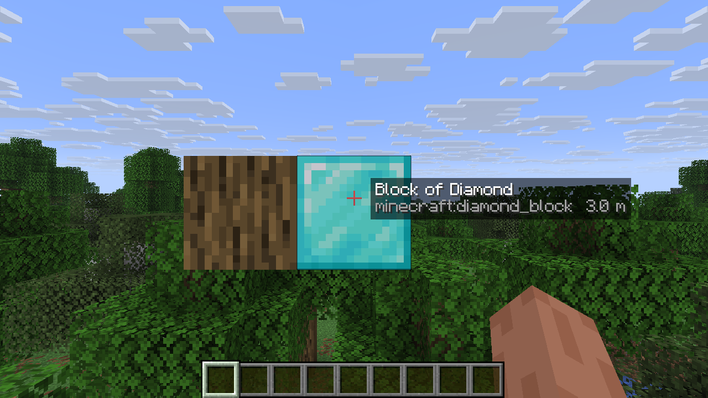

# Block Info

A Jade-style block tooltip for [Horizon](https://github.com/ludovic111/horizon): the block under your
crosshair, its name in your language, its id and how far it is, in a small box beside the crosshair.



## What it shows

- The block's name as your game language names it, from the item registry; blocks with no item get
  their id with the words capitalised ("Water").
- The block id, so a modded block is identifiable.
- The distance from your feet to the point the crosshair meets the block, up to 20 blocks.

The box stays clear of the crosshair and flips to its left near the screen's right edge. Nothing is
drawn when you look at no block within reach, while a screen is open, or with the HUD hidden (F1).

## What it cannot show yet

Horizon's mod API 0.1 hands a mod the player, the world clock and one raycast hit. It has no
`world-read` and no crosshair target with the block's state, so hardness, the right tool, block
states, container contents and entities are out of reach for now. They wait on those interfaces,
not on a bigger mod.

Capabilities it asks for: `game-read` (the player and the raycast), `render` (the box) and `recipes`
(the item table, for names). No chat, no storage, no commands.

## Build

```sh
rustup target add wasm32-unknown-unknown
cargo install --git https://github.com/ludovic111/horizon cargo-horizon-mod
cargo horizon-mod build
cargo horizon-mod check target/horizon-mod/block_info.hmod
cargo horizon-mod test
```

## Install

Put `block_info.hmod` in `horizon-mods/` beside `options.txt`, then turn it on in **Options > Mods**.

## License

MIT.
